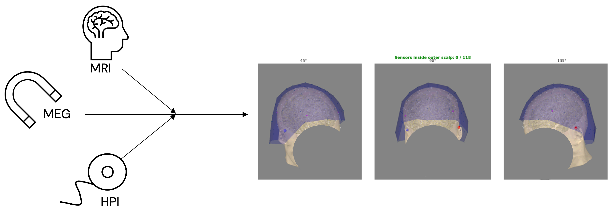
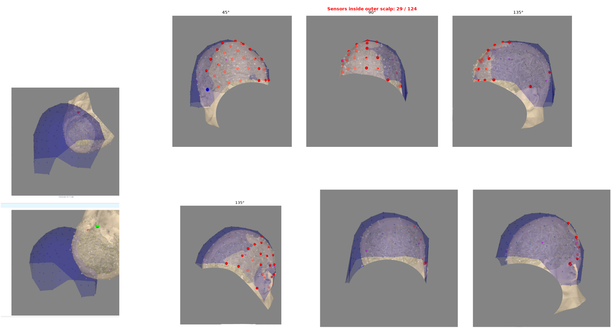
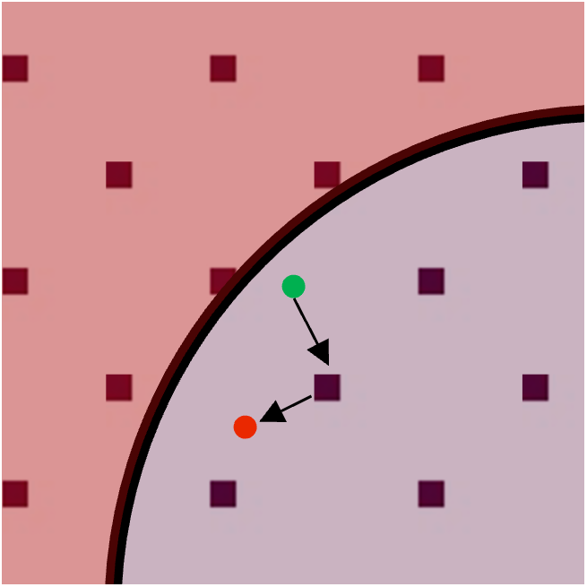
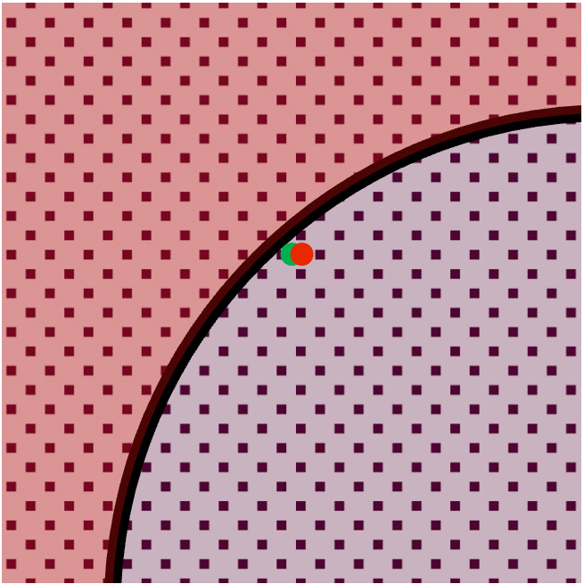
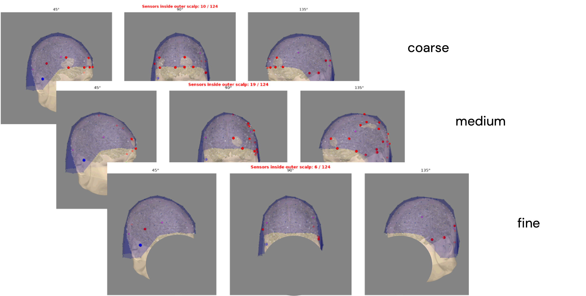

# HPI Coregistration Recommendations

This tutorial explains how to fit head-position indicator (HPI) coils in an
OPM-MEG recording, align the fitted coils to their Polhemus digitisation, and
inspect the result with `opm_utility_scripts`.

!!! info "Practical Recommendations" 

      1. Start with a `--localization-grid fine`, `--gof 0.95`, and `--optimization none`.
      2. Use a clean resting state recording for noisy-channel detection when available and reference snippet is not included in HPI recording use `--bad-channel-policy auto`.
      3. Inspect the fit rather than accepting output from a successful command as proof of a good registration.
      4. Compare settings on representative data before processing a full cohort.

      Recommendations are based on 66 sessions on a sample of 29 participants recorded on single channels using a FieldLine Hedscan OPM system (~110 - 120 active sensors). Sample included varying head-sizes, age range 21-79 and artifacts such as dental wires and implants. Analyses were performed by [Guusje Haver](https://github.com/GuusjeH) with assistance from [Andreas Gerhardsson](https://github.com/agerhardsson), [Christoph Pfeiffer](https://github.com/chrisNatMEG) and [Niklas Edvall](https://github.com/NiklasEdvall).

## The Coordinate Frames

Coregistration connects three coordinate frames:

1. **Device/MEG frame:** the HPI coils are localized relative to the MEG sensor
   array from the magnetic fields recorded during HPI activation.
2. **Head frame:** the Polhemus digitisation records the HPI coil positions and
   head landmarks on the participant.
3. **MRI frame:** the digitised head is aligned to the participant's MRI, for
   example with MNE's coregistration GUI.

This package estimates the device-to-head transform by matching fitted HPI coil
positions to their Polhemus positions. MRI-to-head alignment is a separate
step. The completed transforms connect the sensor geometry to the MRI, which
is required for source modelling and interpretation in anatomical space.




??? warning "A failed HPI fit"
    It is important to make sure to do everything you can to get a good HPI fit. It starts with the head digitization and fitting the participant in the scanner, making sure HPI-coils are note moving or loose. A poor fit can make coregistration with MRI problematic.

    

## What The HPI Fit Does

During the HPI recording, coils are activated one at a time. For each active
coil, the fitter:

1. Estimates the coil's sinusoidal amplitude pattern across MEG sensors at the
   configured drive frequency.
2. Evaluates candidate dipole positions on a grid constrained by the sensor
   geometry.
3. Uses the best grid position as the initial point for a nonlinear dipole fit.
4. Calculates a goodness-of-fit (GOF) value for each fitted coil.
5. Selects coils that pass the GOF threshold, matches those positions to
   Polhemus points, then estimates a rigid device-to-head transform.

The grid is important because the nonlinear fit starts from its best candidate
and can converge to a nearby local minimum. A coarse grid is faster, but its
initial candidate may be too far from a good solution. A finer grid evaluates
more positions and takes longer.

<div class="grid" markdown>





</div>

## Prepare The Inputs

For a full fit, identify:

- **Data file(s):** the recordings to which the resulting transform should be
  applied.
- **HPI file:** the recording containing sequential HPI coil activation.
- **Polhemus file:** the digitisation containing HPI coil positions and
  fiducials (`.json` or `.fif`).
- **Optional reference file:** data without HPI activation, preferably a
  resting-state recording. A clean segment at the end of the HPI recording may
  be used automatically; an empty-room recording is another option.

Check that the selected Polhemus digitisation belongs to the same participant
and that every active HPI coil has a corresponding digitised position.

## Run A Recommended Baseline

A fine grid is recommended with a GOF threshold of `0.95`. The current `coregister`.

```bash
opmutil coregister \
    --data subject_raw.fif \
    --hpi HPIbefore_raw.fif \
    --pol digitisation.json \
    --freq 33 \
    --gof 0.95 \
    --localization-grid fine \
    --optimization none \
    --save --plot
```

Replace file names and frequency with the values for the recording. Add a
reference recording when available:

```bash
opmutil coregister \
    --data subject_raw.fif \
    --hpi HPIbefore_raw.fif \
    --pol digitisation.json \
    --reffile resting_state_raw.fif \
    --freq 33 \
    --gof 0.95 \
    --localization-grid fine \
    --optimization none \
    --save --plot
```

See the [full CLI guide](hpi.md#opmutil-coregister) for other options and
batch processing. `opmutil check` can also inspect an HPI recording without
applying the transform.

## Choose A Localization Grid

| Grid | Approximate spacing | When to use it |
|------|---------------------|----------------|
| `coarse` | 10 mm | Fast exploration; may give a weaker starting point. |
| `medium` | 5 mm | Faster general-purpose default. |
| `fine` | 2 mm | Recommended for careful fits when runtime permits. |
| `mne_stock` | MNE stock grid | Comparison with MNE's stock guess construction. |

The spacing values describe the package's `coarse`, `medium`, and `fine`
settings. `mne_stock` follows a different guess-generation method and should
not be assumed to be equivalent to `coarse`.

Compare fit quality as well as runtime. A low GOF with a coarse grid may mean
the nonlinear fit started in a suboptimal location; it does not by itself prove
that the HPI recording is unusable. Re-running with `fine` can test whether a
better starting candidate improves the fit.




## Set The GOF Threshold

`--gof` determines which fitted coils are eligible for the transform fit. A
coil below the threshold is excluded from subsequent matching and fitting:

```bash
--gof 0.95
```

Use the same threshold when comparing grid choices. A higher threshold is more
selective; however, the transform needs enough valid coils. Inspect which
coils are excluded rather than treating the threshold as a substitute for
reviewing the fit.

## Decide Whether To Refine The Rigid Transform

`--optimization none` retains the initial rigid alignment between fitted coils
and Polhemus positions. `--optimization rigid_gof` (also accepted as `rigid`)
then searches a bounded rotation and translation around that alignment to
improve the dipole field GOF at the digitised positions.

Refinement is not the same as minimizing the geometric residual. It can improve
the field-fit objective while leaving geometric residuals unchanged or larger.  Current code requires at least four GOF-passing coils to apply the rigid GOF refinement; with three, it retains the initial rigid fit.

## Coil Matching

By default, `coregister` centres the fitted and digitised point clouds before
matching coils by nearest position. This reduces sensitivity to a bulk
translation difference between the frames. Use `--no-center-matching` to
disable centring and match the raw coordinates instead; it is an alias for
`--matching-strategy coordinate_nearest`.

Disabling centring often makes little difference. Keep the default unless you have a specific comparison to make, and verify the resulting coil correspondences in either case.

## Inspect And Save The Result

Review the generated alignment plot and command-line diagnostics:

- Check that fitted coil locations lie in plausible positions relative to the
  sensor array and that the fitted/digitised correspondences make sense.
- Review per-coil GOF and identify excluded coils.
- Review residual distances between fitted coil positions and matched
  Polhemus points.
- Compare results with and without refinement if using `rigid_gof`.
- Complete the separate head-to-MRI alignment and inspect that alignment in
  anatomical views.

The `--save` option writes transformed data. The command also records fit
settings alongside saved outputs by default; retain these records with the
analysis so the software version and fit parameters can be traced later.
